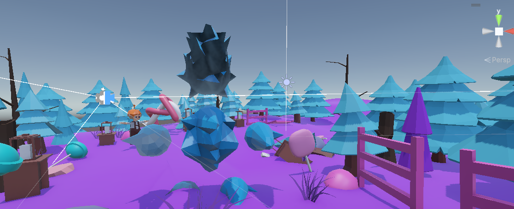

# Crumbs and Candy

  

  <strong>A 3D Escape Card Adventure Inspired by Hansel and Gretel</strong>

---

## About the Game

**Crumbs & Candy** is a 3D escape adventure inspired by the classic fairy tale *Hansel and Gretel*.

Combining **card-based combat, exploration, and resource management**, players must escape the Witch's house, survive a dangerous forest, and navigate branching paths to reach freedom.

Every encounter is a challenge, and every decision brings players closer to—or further away from—their escape.

## Game Progression

Explore the journey through the game's locations:

| # | Location |
|:---:|---|
| 1 | Witch's House |
| 2 | Enemy Encounter 1 |
| 3 | Blacksmith |
| 4 | Enemy Encounter 2 |
| 5 | Shop |
| 6 | Enemy Encounters 3 & 4 |
| 7 | Campfire |
| 8 | Final Boss |
| 🏁 | Exit |

## 🛠️ Third-Party Packages

The project uses Unity's Package Manager to integrate additional tools and functionality.

| Package | Purpose |
|---|---|
| **ProBuilder** | In-editor 3D modeling and level design |
| **Cinemachine** | Advanced camera control and management |

---

  <em>Lost in the woods. Trapped in a witch's house. Find your way out.</em>

